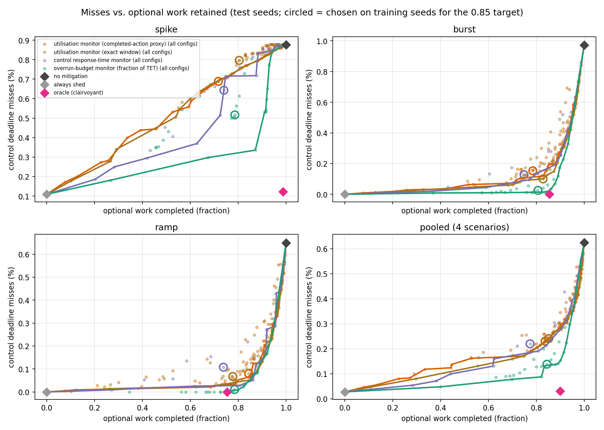

# Overrun-Triggered Load Shedding for Real-Time Control

**An empirical study on a nonpreemptive fixed-priority executor.**

This project investigates whether execution-time overruns provide a useful signal for protecting a periodic control task during transient overload. It combines an independent Python implementation of exceedance-aware response-time analysis, a discrete-event executor simulator, and a motor-speed control model. An online monitor uses the control task's tolerable exceedance threshold (TET) to scale a warning budget and temporarily discard optional callback bodies.

In the supplied V4 experiments, the selected overrun monitor records **0.1380% control deadline misses while retaining 84.43% of optional work**. The exact-window utilization baseline records **0.2408% misses while retaining 85.24%**. This is a simulation result for one illustrative workload; the policy and its Python analysis implementation carry no machine-checked timing guarantee.

## Research question and contribution

**How does an execution-time overrun signal compare with utilization and completed-job response time as a trigger for optional-work shedding?**

The motivation comes from exceedance analysis [1, 2]. Rather than assuming that nominal execution times (NETs) are sound worst-case bounds, this analysis describes response times as a function of accumulated overrun. Bedarkar et al. [2] identify integration with runtime monitoring and mitigation as future work.

This repository contributes:

- An independent implementation of the overhead-aware response-time equations in [2], checked against hand calculations, the paper's published task set, and adversarial simulations.
- A controlled comparison of four causal monitoring policies under shared synthetic disturbance sequences, with parameter selection on training seeds and evaluation on disjoint test seeds.
- Reproducible evidence about deadline misses, optional-work retention, sensitivity to warning budgets and noise, and the limitations of completed-action monitoring.

The contribution is an empirical investigation of the warning signal in this executor model. The analysis originates in [1, 2]; switching to a degraded mode after a budget overrun is not claimed as a new scheduling concept. This is an independent project, with no affiliation with or endorsement by the cited authors.

## Main results

The table reports means over **40 test seeds**, assigning equal weight to four scenarios: nominal operation with simulated OS noise, isolated spikes, bursts, and ramps. For each causal policy family, one configuration was selected on **16 training seeds** to minimize deadline misses subject to retaining at least **85% of optional work on training data**.

| Policy | Control deadline misses | 95% bootstrap interval for miss rate | Optional work retained |
| --- | ---: | ---: | ---: |
| No mitigation | 0.6244% | 0.5680-0.6820% | 100.00% |
| Utilization, completed-action proxy | 0.2304% | 0.2060-0.2551% | 83.65% |
| Utilization, exact window | 0.2408% | 0.2152-0.2668% | 85.24% |
| Control response-time monitor | 0.2196% | 0.1953-0.2440% | 77.38% |
| **Overrun-budget monitor** | **0.1380%** | **0.1149-0.1614%** | **84.43%** |

At these selected configurations, the overrun monitor has **42.7% fewer misses** than the exact-window utilization baseline. The paired difference is **-0.1028 percentage points**, with a 95% bootstrap interval of **[-0.1139, -0.0911]**. It also retains **0.802 percentage points less optional work**. These configurations therefore describe a tradeoff, not an exact equal-retention comparison. The 85% requirement applies to training data and does not guarantee 85% retention on test data.

The selected configurations are `util_t1.00_w50_h1000`, `utilx_t0.50_w100_h300`, `resp_p0.50_h300`, and `overrun_g0.50_h300`. Full results and retention intervals are in [the operating-point table](results/table_operating_points.csv); paired differences are in [the comparison table](results/table_paired_difference.csv).



Curves interpolate tradeoffs among configurations evaluated on test seeds. They are exploratory summaries; an interpolated point is not an independently evaluated policy. At 85% retention, the exploratory miss-rate ratio of overrun to exact-window utilization is **0.577 [0.520, 0.632]**, using a bootstrap that preserves pairing across families. See [the frontier table](results/table_frontier.csv).

Always shedding and the clairvoyant oracle are diagnostic references. Their pooled miss rates are 0.0272% and 0.0307%, retaining 0% and 89.91% of optional work, respectively. Neither is an established optimality bound. Tracking-error changes are small for this plant; the reduction in deadline misses does not establish a comparable improvement in control performance.

## System and monitoring policy

### Executor and workload

The simulator models one single-threaded, nonpreemptive, fixed-priority, polling executor inspired by the Rössl scheduling loop in [2]. Each iteration polls message sockets, selects the highest-priority pending job, and either idles or runs the selected callback to completion. Response time is measured from message arrival to callback completion. All scheduler times use integer microseconds.

| Callback | Role | Period and deadline | NET | Priority | Optional |
| --- | --- | ---: | ---: | ---: | --- |
| `ctrl` | Motor-speed PI controller | 20 ms | 1.5 ms | 1 | No |
| `sens` | Sensor-processing timing workload | 40 ms | 4 ms | 2 | No |
| `tele` | Telemetry timing workload | 50 ms | 8 ms | 3 | Yes |
| `viz` | Visualization timing workload | 100 ms | 12 ms | 4 | Yes |

Smaller priority values indicate higher priority. Nominal callback utilization is 45.5%, excluding scheduler overheads. The motor is a first-order plant with a 0.1 s time constant and a saturated PI controller; samples are captured at message arrival and actuation occurs at callback completion, including late completions. The other callbacks model execution demand rather than implement sensor processing, telemetry, or visualization functions.

### Analysis and warning signal

The analysis implementation computes a response-time bound $R_i(e)$ parameterized by exceedance $e$, and the corresponding TET:

$$
\widehat e_i = \max\{e \geq 0 : R_i(e) \leq D_i\}.
$$

For the default workload, the nominal control response-time bound is **13.995 ms** and the control TET is **6.005 ms**. Replacing optional callback bodies with discard stubs gives a steady degraded-configuration TET of **14.005 ms**. These are analysis calculations, not a verification of transitions between configurations. See [the analytic results](results/table_analytic_robustness.csv).

The runtime monitor accumulates positive deviations of completed actions from their NETs:

$$
E_{\mathrm{obs}} \leftarrow E_{\mathrm{obs}} + \max(0, d_a-N_a),
\qquad
\text{trigger when } E_{\mathrm{obs}} \geq \gamma\widehat e_{\mathrm{ctrl}}.
$$

Here $d_a$ is an action's observed duration and $N_a$ is its NET. A trigger enables shedding for a hold time $H$, extended by subsequent triggers. The selected overrun configuration uses **$\gamma=0.50$ and $H=300$ ms**, corresponding to a budget of approximately 3.00 ms. The accumulator resets after an idling action following a selection that found no pending job. Messages can arrive during that action, so this reset is an implementation heuristic, not the formal quiet instant assumed by the analysis.

The action-level accumulator is not a sound online bound on the paper's job-level exceedance quantity. The TET supplies a tuning scale; the experiments do not demonstrate that TET normalization improves on a tuned absolute budget.

### Compared policies

| Identifier | Decision signal |
| --- | --- |
| `util` | Sum of durations of busy actions completed inside a trailing window. Boundary-crossing actions count in full, so this proxy can exceed 100%. |
| `utilx` | Sliding-window busy fraction, clipping actions at the window boundary; evaluated at busy-action completions. |
| `resp` | A completed control job's response time exceeds a fraction of its deadline. |
| `overrun` | Accumulated observed overrun reaches a fraction of the control TET. |
| `none` | Run all callback bodies. |
| `always` | Discard every optional callback body. |
| `oracle` | Use future slowdown information to discard optional jobs predicted to exceed their NET; noncausal diagnostic. |

All four causal monitors have an illustrative cost of 3 μs per dispatch. Shedding substitutes a 10 μs stub for an optional callback body. Decisions take effect before dispatch; an executing callback cannot be interrupted. A warning can therefore arrive too late to prevent blocking by the current callback.

## Experimental design

| Element | Setting |
| --- | --- |
| Parameter selection | Seeds 0-15; retention targets of 80%, 85%, and 90% |
| Evaluation | Seeds 1000-1039; the table above uses the 85% training target |
| Duration | 40 s per main run; first 0.5 s excluded from primary metrics; 1 s additional drain |
| Main grid | 72 `util`, 72 `utilx`, 21 `resp`, and 27 `overrun` configurations, plus three diagnostic references |
| Pairing | Shared release phases, nominal execution-time draws, slowdown windows, and noise streams for each scenario and seed |
| Primary metrics | Control deadline-miss fraction and NET-weighted fraction of optional work executed |
| Uncertainty | Pool scenarios within each seed, then bootstrap across test seeds; 5,000 resamples for operating points and paired differences, 2,000 for frontiers |

Callback execution times are sampled from 60-100% of NET before disturbances. Scheduler actions have illustrative costs. Synthetic slowdown windows stretch actions according to the slowdown at action start; simulated OS-noise events add stolen time. The disturbance parameters were chosen to produce observable deadline failures and contain both benign and harmful slowdowns. They are not measurements of a deployment.

Supplementary data cover [harsher slowdowns](results/table_robustness_harsh.csv), [noise-rate sensitivity](results/table_noise_sensitivity.csv), [a wider tuning grid](results/table_extended_selection.csv), and [budget sensitivity](results/table_gamma_sensitivity.csv). More sensitive budgets can reduce misses at the expense of retention and noise-triggered shedding; these results do not establish a universally best budget.

## Reproduce

Use **Python 3.12** as the recommended environment. The setup script accepts Python 3.9 or newer, subject to compatible dependency versions. Linux, macOS, or WSL provide the POSIX shell used below. No real-time kernel, proof assistant, or hardware board is required. Dependencies are listed in [requirements.txt](requirements.txt); they are minimum versions, not a locked environment.

Run all commands from the repository root, the directory containing `run_all.py`.

### Inspect the supplied results and run tests

```bash
python3 -m venv .venv
source .venv/bin/activate
python -m pip install -r requirements.txt
python -m pytest -q tests
python verify_results.py
```

The test suite contains **16 test functions**. `verify_results.py` checks the existing result files against selected numerical relationships. It does not rerun the simulations or prove the analysis correct. A passing verifier is an artifact consistency check; when a reference directory is present, its numerical comparison covers selected headline values rather than every raw result.

### Regenerate the main experiment

In a disposable working copy:

```bash
bash setup_and_run.sh smoke
bash setup_and_run.sh full
```

`smoke` checks the pipeline with fewer seeds and a reduced main grid. `full` runs the main study, analysis validation, and selected harsher-slowdown and noise checks. The full study includes tens of thousands of simulations; runtime depends on hardware and worker count.

The helper recreates `.venv`, `results/`, and `figures/`. It preserves existing result and figure directories as `results_reference/` and `figures_reference/` only when those reference directories do not already exist. Use a separate copy if you need to preserve local experiments.

| Mode | Training / test seeds | Main-run duration | Purpose |
| --- | ---: | ---: | --- |
| `smoke` | 3 / 4 | 20 s | Pipeline check |
| `quick` | 8 / 20 | 40 s | Main grids with fewer seeds |
| `full` | 16 / 40 | 40 s | Main reported experiment |

Reduced modes are not expected to reproduce the headline statistics. To control parallelism or the output directory directly:

```bash
python run_all.py --mode full --jobs 4 --out results_full
```

Always use a fresh output directory when changing mode, duration, workload, or code. Resumption identifies existing runs by policy, scenario, and seed; it does not validate their duration or configuration. Figures still go to `figures/` even with `--out`. Supplemental CSV caches can also retain older settings. The verifier reads only `results/`.

### Supplementary stages

The wider-grid study, idle-shortcut sample, and two small analytic scripts are separate from the default pipeline. After a full run, with the environment activated:

```bash
python run_all.py --mode full --stage extend --jobs 4
python run_all.py --mode full --stage analyze
python run_all.py --mode full --stage idlecheck
python calibration_latency.py
python chunking_whatif.py
```

The second command updates analysis outputs to incorporate the extended-grid selections in the supplementary checks. The chunking script is an analytic what-if calculation; it does not implement or evaluate chunked callbacks in the simulator. Individual pipeline stages are `validate`, `sweep`, `resp`, `utilx`, `analyze`, `extend`, and `idlecheck`; use `python run_all.py --help` for arguments.

## Validation and limitations

The analysis implementation has three finite consistency checks:

1. **Hand calculations and unit tests** for response-time bounds, TETs, scheduler behavior, and monitor semantics.
2. **The published Table III workload in [2].** Scheduler overheads are set to zero because the required basic-action NETs are not supplied in that table. The largest TET deviation is 0.091 ms. Six of seven recovery times differ by less than 0.1 ms. For the lowest-priority callback, the bound changes from 200.000 ms at the computed TET to 292.941 ms one microsecond later, compared with 292.990 ms published. This is consistent with an arrival-curve discontinuity, not evidence of an exact reproduction of the original platform.
3. **Adversarial simulation.** The supplied full validation covers 4,200 randomized runs with zero observed violations of the calculated response-time bounds. These runs test consistency and do not establish soundness for all executions.

See [Table III calculations](results/validation_table3.csv), [adversarial results](results/validation_soundness.csv), and [the validation figure](figures/fig5_validation.png).

Several limits matter when interpreting the results:

- **One illustrative system.** The study uses one core, one four-callback workload, a first-order plant, and synthetic disturbances. NETs, scheduler overheads, and monitor costs are modeling choices rather than hardware measurements.
- **No inherited formal guarantee.** The Python implementation, online accumulator, reset rule, and mode transitions are unverified. The machine-checked results in [2] do not transfer to this artifact.
- **Approximate idle skipping.** The default simulator skips idle polling iterations while replaying noise events. The shipped [96-pair shortcut check](results/idle_equivalence.csv) finds differences in miss rates in 5 pairs and retention in 9 pairs; maximum absolute differences are 0.4211 and 3.4586 percentage points, respectively. That sample uses 10 s runs and includes `overrun_g0.05_h100`, not the main selected `overrun_g0.50_h300`. It does not establish equivalence for all reported configurations.
- **Diagnostic counters have limited meaning.** Miss-attribution counters describe what was running at message arrival, not warning history or causality. Loss of an analytic certificate does not itself prove that a miss is unavoidable. The false-trigger counter includes warm-up and drain episodes and divides by nominal run duration.
- **Evidence depends on policy tuning and baselines.** Test retention differs across selected policies. Test-derived frontiers and later analyses are exploratory. The experiments do not establish optimality, superiority to mixed-criticality or reservation-based methods, or an advantage attributable specifically to TET normalization.
- **Control benefits remain limited.** Timing improvements should be separated from the small tracking-error changes observed with this plant and controller.

Legacy identifiers such as `unavoidable_slowdowns`, `miss_late_warning`, and `misses_blocked_by_unwarned_optional` remain in code and CSVs for continuity.
## Repository guide

| Path | Purpose |
| --- | --- |
| [ovb/analysis.py](ovb/analysis.py) | Overhead-aware response-time bounds, TET, and robustness calculations |
| [ovb/sim.py](ovb/sim.py) | Discrete-event executor and timing metrics |
| [ovb/monitors.py](ovb/monitors.py) | Four causal monitors and diagnostic references |
| [ovb/taskset.py](ovb/taskset.py), [ovb/disturbances.py](ovb/disturbances.py), [ovb/plant.py](ovb/plant.py) | Workload, synthetic disturbances, plant, and controller |
| [ovb/experiments.py](ovb/experiments.py), [ovb/analyze.py](ovb/analyze.py) | Parameter sweeps, training selection, uncertainty estimates, and figures |
| [ovb/extend.py](ovb/extend.py), [ovb/robustness.py](ovb/robustness.py), [ovb/idlecheck.py](ovb/idlecheck.py) | Supplementary grids, noise sensitivity, and idle-shortcut checks |
| [ovb/validate.py](ovb/validate.py), [tests/](tests/) | Analysis comparisons and implementation tests |
| [run_all.py](run_all.py), [setup_and_run.sh](setup_and_run.sh), [verify_results.py](verify_results.py) | Pipeline, setup helper, and result checks |
| [results/](results/) | Raw per-run CSVs, summary tables, and validation outputs |
| [figures/](figures/) | Tradeoffs, a timing trace, miss-attribution diagnostics, validation, and budget sensitivity |
| [calibration_latency.py](calibration_latency.py), [chunking_whatif.py](chunking_whatif.py) | Supplementary controller calibration and analytic chunking calculation |

The [timing and tracking trace](figures/fig1_timing_trace.png) illustrates one deliberately selected difficult burst; it does not summarize aggregate performance. Additional figures cover [execution at the arrival of missed jobs](figures/fig4_miss_causes.png) and [warning-budget sensitivity](figures/fig6_gamma_sensitivity.png).

## Open research directions

- Validate the executor and monitor with measured NETs, scheduler overheads, and real disturbance traces on Linux hardware.
- Account explicitly for detection latency, reset semantics, and the transition into and out of a degraded configuration.
- Evaluate multiple task sets and disturbance distributions, using fresh test seeds after fixing policy and baseline choices.
- Compare with mixed-criticality and reservation-based baselines, and separate the effect of NET-relative sensing from budget scaling.
- Implement chunked optional callbacks and study their blocking, overhead, and control-performance tradeoffs.


## References

[1] Matteo Zini, Filip Marković, Daniel Casini, Alessandro Biondi, and Björn B. Brandenburg. **In Search of Butterflies: Exceedance Analysis for Real-Time Systems under Transient Overload.** Proceedings of the 45th IEEE Real-Time Systems Symposium (RTSS 2024), pp. 229-242, December 2024. [Paper](https://people.mpi-sws.org/~bbb/papers/pdf/rtss24-butterflies.pdf).

[2] Kimaya Bedarkar, Bite Ye, Deepak Garg, Derek Dreyer, and Björn B. Brandenburg. **From Estimates to Guarantees: Verified Exceedance Analysis on Commodity Hardware.** Proceedings of the 47th IEEE Real-Time Systems Symposium (RTSS 2026), to appear, December 2026. [Paper](https://people.mpi-sws.org/~bbb/papers/pdf/rtss26-re.pdf) · [Publication listing](https://people.mpi-sws.org/~bbb/papers/).

Please cite the original papers for exceedance analysis and identify the repository revision when referring to these experiments.

## Author and license

**Mohamed Ghoneim**  
Systems and Control Engineering, King Fahd University of Petroleum and Minerals (KFUPM), Dhahran, Saudi Arabia.

Released under the [MIT License](LICENSE).
