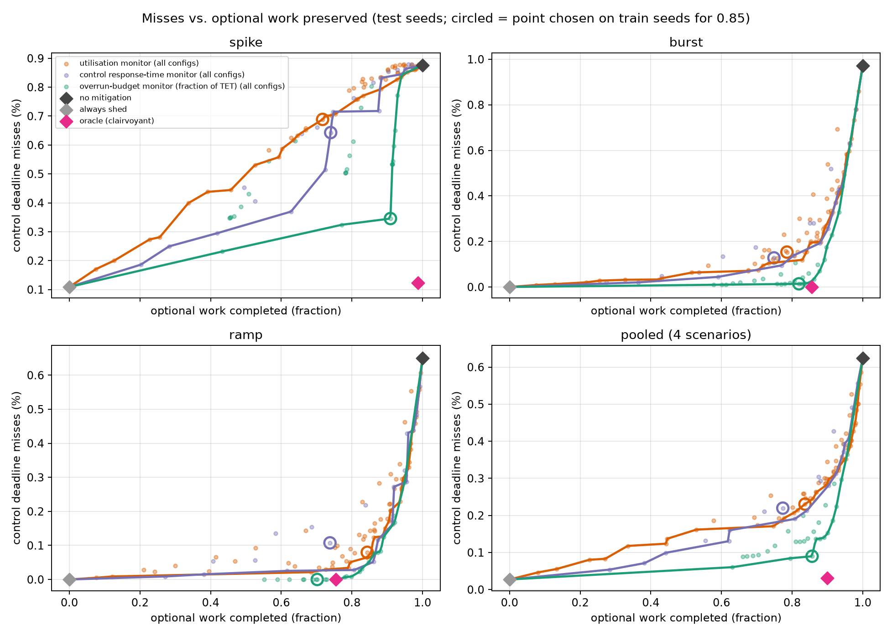

# Overrun Monitor

**Execution-time-aware load shedding for simulated real-time control.**

This project studies whether execution-time overruns provide a useful signal for protecting a periodic control loop during transient processor slowdowns. It combines a Python implementation of exceedance-aware response-time analysis, a discrete-event scheduler, and a motor-speed control simulation. The runtime policy uses the control task's tolerable exceedance threshold (TET) to scale its warning budget, then temporarily discards optional callbacks when observed overruns accumulate.

In the supplied experiments, the selected overrun monitor reduces the control deadline-miss rate from **0.2304% to 0.0899%** relative to the implemented utilization baseline, while retaining **85.67% of optional work**. These are simulation results for the workload and disturbances described below. The analysis and monitor are independently implemented research code; they carry no machine-checked timing guarantee.

## Results

The following configurations were selected on 16 training seeds to minimize deadline misses while retaining at least 85% of optional work on the training data. Results are evaluated on 40 disjoint test seeds, with equal weight assigned to four scenarios.

| Policy | Optional work retained on test runs | Control deadline misses | 95% bootstrap CI for miss rate |
| --- | ---: | ---: | ---: |
| No mitigation | 100.00% | 0.6244% | 0.5696–0.6823% |
| Utilization monitor | 83.65% | 0.2304% | 0.2060–0.2551% |
| Control response-time monitor | 77.38% | 0.2196% | 0.1946–0.2443% |
| **Overrun monitor** | **85.67%** | **0.0899%** | **0.0759–0.1041%** |

At these selected operating points, the overrun monitor has **61.0% fewer misses** than the utilization baseline. The paired difference is **−0.1405 percentage points**, with a 95% bootstrap interval of **[−0.1611, −0.1218]**. The 85% retention target is a training constraint: the actual test retention differs between policies, so this table is not an exact equal-retention comparison.

The selected configurations are `util_t1.00_w50_h1000`, `resp_p0.50_h300`, and `overrun_g0.05_h100`. Full values are in [the operating-point table](results/table_operating_points.csv) and [paired comparisons](results/table_paired_difference.csv).



Circles mark the configurations selected on training data. Curves summarize the tested configurations on test data and interpolate between them; they are exploratory tradeoff summaries, not independently validated operating points.

Tracking error is a secondary outcome. For this plant, the improvement in deadline misses does not translate into a comparably large improvement in RMS tracking error. See the [per-scenario results](results/table_per_scenario.csv) and [timing and tracking trace](figures/fig1_timing_trace.png). The trace is deliberately selected to illustrate a difficult burst; aggregate results come from all test seeds.

## Method

The timing analysis follows Section II of Bedarkar et al., *From Estimates to Guarantees: Verified Exceedance Analysis on Commodity Hardware* [1]. Given a response-time bound $R_i(e)$ parameterized by accumulated exceedance $e$, the control task's TET is

$$
\widehat e_i = \max\{e \geq 0 : R_i(e) \leq D_i\}.
$$

The implementation accounts for polling, selection, dispatch, completion, and idling overheads. For the default task set, it computes a nominal control response-time bound of **13.995 ms** and a TET of **6.005 ms**. Replacing optional callback bodies with discard stubs gives a steady degraded-configuration TET of **14.005 ms**. These calculations explain the available timing margin; they do not establish a guarantee for transitions between configurations.

The online monitor accumulates the positive overrun of each completed scheduler action or callback:

$$
E_{\mathrm{obs}} \leftarrow E_{\mathrm{obs}} + \max(0, d_a - N_a),
\qquad
\text{trigger when } E_{\mathrm{obs}} \geq \gamma\widehat e_{\mathrm{ctrl}}.
$$

Here, $d_a$ is an observed duration and $N_a$ its nominal execution time (NET). The accumulator resets at an idling phase, and a trigger enables shedding for a configurable hold time. This action-level signal is a heuristic: it is not the job-level exceedance quantity used in the paper's theorem. The TET supplies a scale for tuning, not a certified runtime safety threshold.

### Simulated system

The executor is single-threaded, nonpreemptive, and fixed-priority, with one simulated message socket per callback. Smaller priority values indicate higher priority. All scheduler times use integer microseconds.

| Callback | Function | Period / deadline | Nominal execution time | Priority | Optional |
| --- | --- | ---: | ---: | ---: | --- |
| `ctrl` | Motor-speed PI control | 20 ms | 1.5 ms | 1 | No |
| `sens` | Sensor-processing workload | 40 ms | 4 ms | 2 | No |
| `tele` | Telemetry workload | 50 ms | 8 ms | 3 | Yes |
| `viz` | Visualization workload | 100 ms | 12 ms | 4 | Yes |

Nominal callback utilization is 45.5%, excluding scheduler overheads. Sensor processing, telemetry, and visualization are timing workloads; the repository does not implement those application functions. The motor plant is modeled explicitly, with time constant 0.1 s and a saturated PI controller. Control samples are captured at message arrival and applied at callback completion, including late completions. Plant evolution between events is integrated analytically.

### Policies

| Policy | Decision signal |
| --- | --- |
| `none` | Execute all callbacks. |
| `util` | Trigger when completed busy-action durations in a trailing window exceed a threshold. |
| `resp` | Trigger after a completed control job exceeds a fraction of its deadline. |
| `overrun` | Trigger when observed overruns reach a fraction of the control TET. |
| `always` | Discard every optional callback body. |
| `oracle` | Use future slowdown information to discard an optional job predicted to exceed its NET; a noncausal diagnostic reference. |

The three causal monitors have a modeled cost of 3 μs per dispatch and configurable hold times. Shedding replaces an optional callback body with a 10 μs stub. Decisions take effect only before dispatch: a callback already executing cannot be stopped.

## Experimental design and validation

The main experiment uses four scenarios: nominal execution with simulated OS noise (`none`), short severe slowdowns (`spike`), longer slowdowns (`burst`), and triangular slowdowns (`ramp`). Disturbances are synthetic. Callback costs are sampled from 60–100% of their NET before slowdown and noise are applied.

- **Training:** seeds 0–15. **Testing:** seeds 1000–1039.
- **Duration:** 40 seconds per main run, excluding the first 0.5 seconds from evaluation. The simulator continues for one additional second to complete outstanding work.
- **Pairing:** policies share release phases, nominal execution-time draws, slowdown windows, and noise streams for each scenario and seed.
- **Selection:** minimize training miss rate subject to optional-work retention targets of 80%, 85%, or 90%. The main grids contain 72 utilization, 27 overrun, and 21 response-time configurations, plus three reference policies.
- **Metrics:** deadline-miss rate and optional work retained, weighted by each callback's NET. Secondary metrics include consecutive misses, response times, RMS tracking error, and detection behavior.
- **Uncertainty:** pool the four scenarios within each seed, then bootstrap over test seeds. Operating-point intervals and paired differences use 5,000 resamples.

[PLAN.md](PLAN.md) records the original design. The response-time baseline, expanded tuning grids, and noise-rate sensitivity analysis extend that design. The expanded-grid study is exploratory and reuses the test-seed set; it should not be treated as a new independent confirmation. Model choices are documented in [MODEL.md](MODEL.md).

Validation includes:

1. **15 test functions** covering hand calculations, response-time behavior, scheduler behavior, and monitor semantics.
2. **A Table III comparison** using the paper's callback parameters with scheduler overheads set to zero because the basic-action NETs are omitted from the paper. The maximum TET difference is 0.091 ms. The lowest-priority recovery bound is sensitive to an arrival-curve boundary: it changes from 200.000 ms to 292.941 ms when exceedance increases by 1 μs.
3. **Adversarial simulations** comparing observed response times with $R(E)$. The supplied full validation covers 4,200 runs with no observed violations. This is a finite consistency check, not a proof.

See [Table III calculations](results/validation_table3.csv), [adversarial results](results/validation_soundness.csv), and [the validation figure](figures/fig5_validation.png).

## Reproduce

Use Python 3.10 or newer; Python 3.12 is recommended. Dependencies are listed in [requirements.txt](requirements.txt). The commands below use a POSIX shell. No real-time kernel, hardware board, or proof assistant is required.

To install dependencies and inspect the supplied results:

```bash
git clone https://github.com/mohamedghoneim281/overrun-monitor.git
cd overrun-monitor
python3 -m venv .venv
. .venv/bin/activate
python -m pip install -r requirements.txt
python -m pytest -q tests
python verify_results.py
```

`verify_results.py` checks the CSVs in `results/`; it does not rerun the simulations. To regenerate the main experiments, tables, and figures:

```bash
bash setup_and_run.sh full
```

The helper recreates `.venv`, `results/`, and `figures/`. Use a clean working copy if you want to preserve local experiments. It preserves existing outputs in reference directories only when those directories do not already exist.

| Mode | Training / test seeds | Simulated duration | Purpose |
| --- | ---: | ---: | --- |
| `smoke` | 3 / 4 | 20 s | Check the pipeline with a reduced main policy grid. |
| `quick` | 8 / 20 | 40 s | Run the main grid with fewer seeds. |
| `full` | 16 / 40 | 40 s | Reproduce the main reported experiment. |

Select a mode with `bash setup_and_run.sh smoke`, `quick`, or `full`. Reduced modes are not expected to reproduce the headline statistics. Runtime depends on the machine and worker count.

The expanded-grid experiment is a separate optional stage, run after a full sweep:

```bash
python run_all.py --mode full --stage extend --jobs 4
```

For direct control, `run_all.py` supports `--jobs`, `--out`, and the stages `validate`, `sweep`, `resp`, `analyze`, and `extend`. For example:

```bash
python run_all.py --mode full --jobs 4 --out results_full
```

Use a fresh output directory when changing modes, task parameters, or experiment settings: resumption identifies existing runs by policy, scenario, and seed, without checking the simulation duration or configuration. Figures always go to `figures/`, even with `--out`. Analysis can run supplemental simulations when their data are missing, and reuses cached supplemental CSVs when present. The results verifier reads only `results/`.

## Scope and limitations

- **Simulation evidence.** Timing parameters, monitor costs, and disturbances are illustrative. No hardware execution-time measurements or deployment results are included.
- **No inherited formal guarantee.** The Python equations, simulator, and mitigation policy are not verified in Rocq. A steady degraded-configuration bound does not verify a mode transition.
- **Late warnings remain possible.** Completed-action monitoring cannot prevent the first long nonpreemptive callback from blocking control. Miss-attribution counters identify what was running at arrival; they are diagnostic observations rather than causal proofs.
- **Baseline and workload dependence.** The utilization baseline charges whole completed actions to its window, including boundary-crossing actions, so it is an approximation to continuous windowed utilization. Conclusions apply to this implementation and the tested task set. Broader workloads and an exact window-overlap baseline are useful next checks.
- **Empirical parameter selection.** Favorable overrun thresholds lie below the TET. The experiments establish the performance of the tuned signal; they do not establish that TET normalization itself is essential or that the policy is optimal.

The repository also includes [harsher-slowdown results](results/table_robustness_harsh.csv), [noise-rate sensitivity](results/table_noise_sensitivity.csv), [expanded-grid results](results/table_extended_selection.csv), and [budget sensitivity](figures/fig6_gamma_sensitivity.png). These extend the simulation evidence. Hardware measurements and explicit analysis of monitoring delays and mode transitions remain follow-up work.

## Code guide

| File or directory | Role |
| --- | --- |
| [ovb/analysis.py](ovb/analysis.py) | Overhead accounting, response-time bounds, TET, and recovery calculations |
| [ovb/sim.py](ovb/sim.py) | Scheduler simulation and timing metrics |
| [ovb/monitors.py](ovb/monitors.py) | Causal policies and diagnostic references |
| [ovb/taskset.py](ovb/taskset.py), [ovb/plant.py](ovb/plant.py), [ovb/disturbances.py](ovb/disturbances.py) | Application parameters, motor model, and disturbance generation |
| [ovb/experiments.py](ovb/experiments.py), [ovb/analyze.py](ovb/analyze.py) | Policy sweeps, selection, statistics, and plots |
| [ovb/extend.py](ovb/extend.py), [ovb/robustness.py](ovb/robustness.py) | Expanded grids and noise-rate sensitivity |
| [ovb/validate.py](ovb/validate.py), [tests/](tests/) | Analysis comparisons and implementation tests |
| [results/](results/), [figures/](figures/) | Supplied experiment data, tables, and figures |

## Reference

[1] Kimaya Bedarkar, Bite Ye, Deepak Garg, Derek Dreyer, and Björn B. Brandenburg. **From Estimates to Guarantees: Verified Exceedance Analysis on Commodity Hardware.** 47th IEEE Real-Time Systems Symposium (RTSS 2026), to appear, December 2026. [Paper](https://people.mpi-sws.org/~bbb/papers/pdf/rtss26-re.pdf) · [Authors' publication listing](https://people.mpi-sws.org/~bbb/papers/).

The response-time equations and TET definition originate in [1]. This repository contributes an independent Python implementation and a simulation study of runtime shedding policies motivated by that work.
